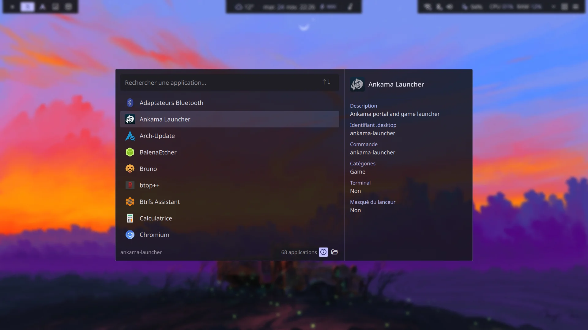
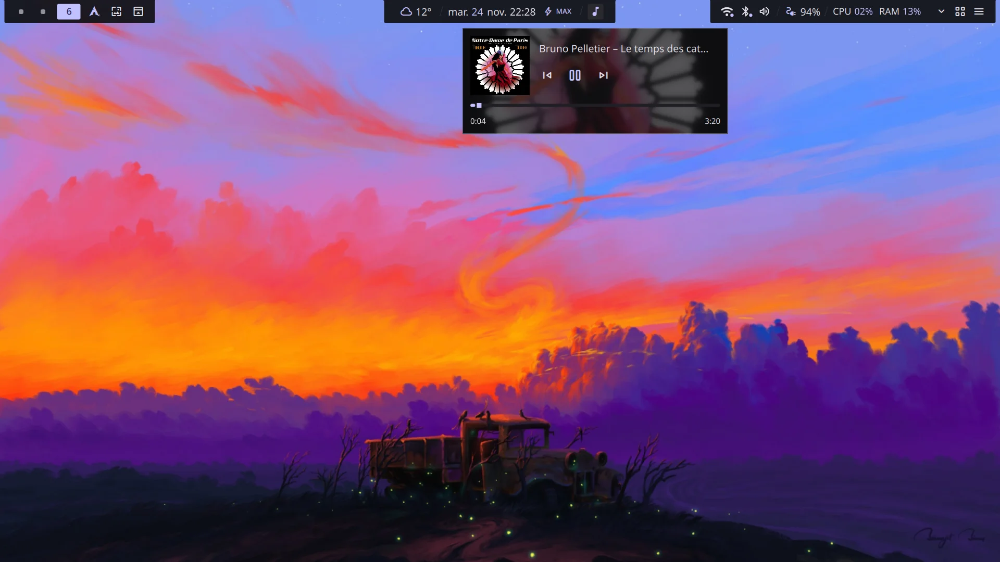
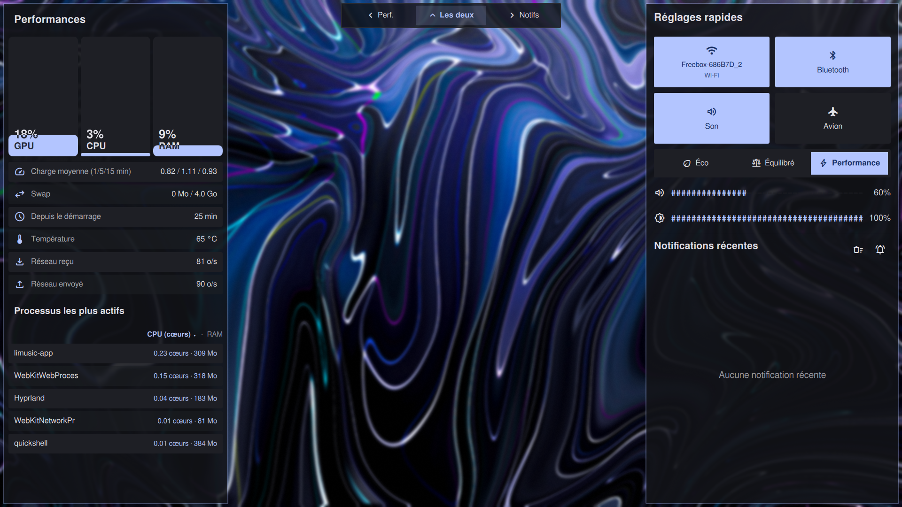
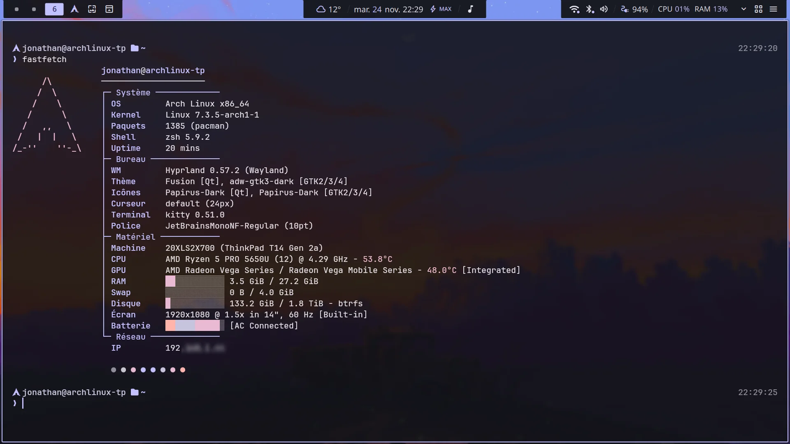
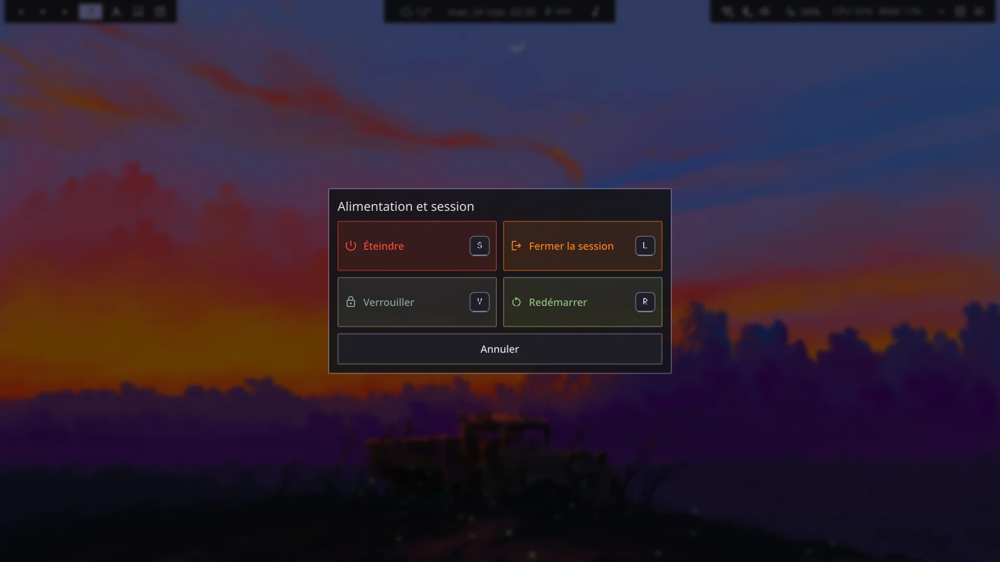
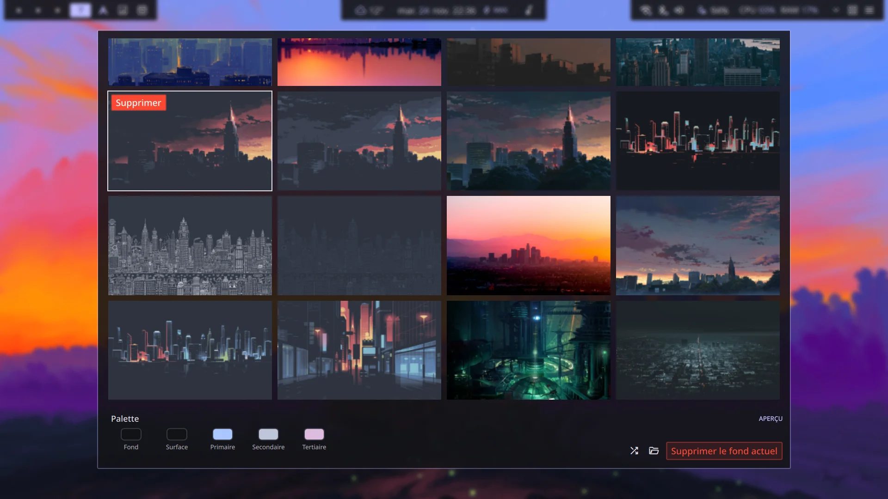

# Quickshell Desktop Configuration

> **Note**
>
> These dotfiles were made for a **Lenovo ThinkPad T14 Gen 2**.
>
> They are provided as-is, with no guarantee that they will work correctly on
> other hardware. Differences in displays, GPUs, audio, networking, battery
> management, and power controls may require some adjustments.
>
> In short: it works on my machine. From there, Linux may have its own ideas.

## Features

### Top bar

- Hyprland workspace controls
- Clock, with a calendar dropdown
- Weather (icon and temperature before the date), with a forecast dropdown
- Media controls
- Battery and system indicators
- Notifications
- Power menu

### Calendar

Click the date in the bar to open the calendar dropdown:

- Month grid starting on Monday, with the current day highlighted
- ISO week numbers
- Previous/next month with the arrows or the mouse wheel
- Click the month title to come back to the current month

The calendar is loaded on demand and only exists while it is open.

### Weather

The weather icon and the current temperature are shown right before the day
and the time in the bar. Click them to open the weather dropdown:

- Current conditions with a short description
- Today's minimum and maximum
- Feels-like temperature, humidity and wind
- Forecast for the next five days, with the chance of rain

Data comes from [Open-Meteo](https://open-meteo.com), which needs no API key.
The weather is hidden until the first successful update, and if the network is
unavailable the last known values stay on screen. See
[Weather](#weather-1) in the configuration section to set your location.

### Control panel

Quick access to:

- Wi-Fi
- Bluetooth
- Volume
- Airplane mode
- Brightness
- TLP power profiles
- Notification history
- System information
- Process and performance information

The panel is named **Control Center** in the interface. Its keyboard button
opens the shortcuts panel, which reads descriptions from `-- @desc:` comments
in the keybindings file (by default `~/.config/hypr/keybinding.lua`).

### Wallpaper tools

The wallpaper system includes:

- Wallpaper picker
- Memory-conscious loading of wallpaper previews
- Current and hovered wallpaper color palette previews
- Random wallpaper selection
- Confirmed wallpaper deletion from the picker
- Bar wallpaper button: left-click opens the picker, right-click selects a
  random wallpaper, and middle-click deletes the current wallpaper and applies
  a random one
- Matugen color generation
- Shared colors between the interface and Hyprland borders

Changing the wallpaper can therefore also change the overall color palette of
the desktop.

### Other panels

- Application launcher with application metadata
- Power/session menu
- Volume OSD
- Brightness OSD

### Application launcher

Configure the web search URL in `config.jsonc` under `launcher.searchUrl`.
Use `{query}` where the encoded search terms should appear; the default is
`https://duckduckgo.com/?q={query}`.
Press Enter to launch the selected application, or to search the web when no
application matches. The web-search icon also starts a search.

Open the information button next to the application count to show details for
the selected application, including its `.desktop` ID, `Exec` command,
categories, and keywords. The folder button opens the user applications
directory (`$XDG_DATA_HOME/applications`, or
`~/.local/share/applications`) in Dolphin. Add or edit `.desktop` files there
to customize launch commands, names, and icons.

### Keyboard shortcuts

The shortcuts panel reads the keybindings file set in `config.jsonc`:

```jsonc
"keybindings": {
    "file": "~/.config/hypr/keybinding.lua",
},
```

Annotate bindings with these comments:

- `-- @title: ...` adds a section heading above the following shortcuts.
- `-- @desc: ...` adds a description to the next `hl.bind(...)` line.
- `-- @ignore` hides the next binding from the panel (useful for media keys,
  volume, brightness, and other bindings that don't need to be displayed).

Changes to the file or to `config.jsonc` are picked up automatically; the
configuration reloads without restarting Quickshell.

### Power management

Optional power-related features include:

- Low-battery profile fallback
- Eco mode
- Brightness adjustments
- TLP power profiles
- Battery charge thresholds

### Battery charge modes

Two charge modes are available:

- **Travel** — 0 / 95%
- **Safe** — 75 / 80%

These make it easy to switch between normal use and a more battery-friendly
charging range.

---

## Screenshots

| Application launcher                       | Desktop and media controls                                 |
| ------------------------------------------ | ---------------------------------------------------------- |
|  |  |

| Performance and quick settings                              | Desktop overview                      |
| ----------------------------------------------------------- | ------------------------------------- |
|  |  |

| Power menu                                      | Wallpaper picker                      |
| ----------------------------------------------- | ------------------------------------- |
|  |  |

---

## Requirements

The setup requires:

- Linux with **Wayland**
- **Hyprland**
- **Quickshell**
- The Quickshell modules used by this configuration:
    - Wayland
    - Hyprland
    - UPower
    - MPRIS
    - PipeWire
    - Notifications

Common utilities:

- `bash`
- `curl`
- `cat`
- `ps`
- `nmcli`
- `bluetoothctl`
- `wpctl`
- `brightnessctl`
- `notify-send`
- `systemctl`
- `hyprctl`
- `hyprlock`

For power management:

- **TLP**
- A running **Polkit authentication agent**

For wallpaper colors:

- **Matugen**

For the weather:

- Internet access (the forecast comes from Open-Meteo, no account or API key
  needed)
- The **Material Symbols** icon font, which also provides the weather icons

Optional integrations:

- `pavucontrol`
- `nm-connection-editor`
- `xdg-open`
- `hyprshutdown`
- [Thyx](https://github.com/rccyx/thyx), an SDDM login theme (not a session lock screen)

A wallpaper collection is expected in:

```text
~/Pictures/wallpapers
```

Some system readings rely on Linux `/proc` and `/sys` interfaces being
available.

---

## Install and run

Place this directory at:

```text
~/.config/quickshell
```

Then run:

```sh
cd ~/.config/quickshell
./setup-config.sh
qs -p ~/.config/quickshell
```

The shell is designed to run inside a Hyprland session.

Some commands use Hyprland IPC and will therefore require adjustments when
used with another compositor.

---

## Configuration

The main configuration is stored in [`config.jsonc`](./config.jsonc). It can
be used to change:

- Colors
- Refresh intervals
- Weather location, refresh interval and on/off switch
- Default control-panel view
- Wi-Fi, Bluetooth, file-manager, and fallback text-editor applications
- Wi-Fi and Bluetooth bar right-click actions
- Update manager command
- Power fallback settings
- Eco levels
- Wallpaper palette labels
- Keybindings file location (`keybindings.file`)

[`setup-config.sh`](./setup-config.sh) creates a default `config.jsonc` if
one does not already exist. If the file already exists, it leaves it untouched.

Set applications in the `apps` category: `wifi`, `bluetooth`, `fileManager`,
and `textEditor`. The settings button first opens `config.jsonc` with the
system's default application and falls back to `apps.textEditor` if that fails.
Set bar right-click actions in `panel.wifi.rightClick` and
`panel.bluetooth.rightClick` to `"toggle"` to enable/disable the connection, or
`"none"` to disable the action. Older configurations using `bar` with
`application` values are still supported.

Dolphin is used by default to open the wallpaper folder and the launcher's
custom applications folder. Set `apps.fileManager` to change it. Configure the
wallpaper folder with `wallpaper.directory`; it accepts an absolute path or a
path starting with `~/`. The picker, bar actions, and wallpaper script all use
this directory.

By default, the wallpaper picker reads images from:

```text
~/Pictures/wallpapers
```

Selected wallpapers and generated theme colors are stored under:

```text
~/.cache
```

### Weather

The weather is configured in the `weather` section of `config.jsonc`:

```jsonc
"weather": {
    "enabled": true,
    "latitude": 48.8566,
    "longitude": 2.3522,
    "refreshMinutes": 30,
},
```

- `enabled` — set to `false` to hide the weather from the bar.
- `latitude` and `longitude` — your location, in decimal degrees. The default
  is Paris.
- `refreshMinutes` — how often the weather is updated, in minutes. The default
  is 30.

If the section is missing, the weather uses these defaults (Paris, every 30
minutes). Changing the coordinates in `config.jsonc` updates the weather
without restarting Quickshell.

Weather data is provided by [Open-Meteo](https://open-meteo.com). Their free
service is meant for non-commercial use and asks for attribution, which is why
the dropdown shows a small "Open-Meteo.com" credit.

---

## TLP profiles, charge limits and Polkit

The quick-settings panel provides three power profiles:

- **Eco**
- **Balanced**
- **Performance**

Selecting a profile closes the panel and runs the corresponding `/usr/bin/tlp`
command through `pkexec`.

A running Polkit authentication agent is therefore required.

Battery charge modes use the same mechanism through `tlp setcharge`.

The configured modes are:

- **Travel** — 0 / 95%
- **Safe** — 75 / 80%

These thresholds are temporary TLP settings and may be replaced when TLP
reapplies its configured battery thresholds.

No passwordless sudoers rule is required.

Make sure that:

- TLP is installed;
- a Polkit authentication agent is running;
- the system allows the authenticated user to run `/usr/bin/tlp`.

The scripts currently expect:

```text
/usr/bin/tlp
/usr/bin/tlp-stat
```

Adjust [`scripts/tlp-power-profile.sh`](./scripts/tlp-power-profile.sh) if they are
installed elsewhere.

The active TLP profile is read with `tlp-stat -s` without elevation.

Charge threshold information is read from the battery's sysfs interface.

If the battery hardware or driver does not support charge thresholds, these
controls will not be available.

---

## Hardware and portability

Some parts of the configuration depend on the hardware exposing specific Linux
interfaces.

### GPU

GPU usage is currently read from AMD-style paths:

```text
/sys/class/drm/card*/device/gpu_busy_percent
```

This may therefore be unavailable on other GPUs or kernels.

### System information

Temperature, battery, brightness, and power information depend on what the
hardware and kernel expose.

### Adapting the configuration

When using this setup on another machine, check:

- `panels/notifications/Notifications.qml`
- `components/action/PowerSlider.qml`
- `scripts/`

Some paths and commands may need to be changed depending on the installation.

Power, logout, reboot, lock, network, Bluetooth, and brightness controls
perform real system actions.

So yes, the buttons actually do things.

---

## Layout

```text
shell.qml
```

Main application entry point.

```text
panels/
```

Bar,launcher, control center, notifications, performance, wallpaper,
OSD, power, and keyboard-shortcut interfaces.

The files are grouped into `apps/`, `controls/`, `desktop/`, `notifications/`,
`services/`, and `shell/`. The calendar and weather dropdowns live in `apps/`,
and the weather data service (`WeatherService.qml`) lives in `services/`.

```text
components/
```

Reusable UI components.

The components are grouped into `action/`, `info/`, `notification/`, and
`tooltip/`.

```text
theme/Theme.qml
```

Loads the JSONC configuration and generated wallpaper colors.

```text
scripts/
```

Wallpaper, TLP power-profile, desktop-entry-folder helpers, and desktop-entry
and keyboard-binding parsers.

---

## About the project

This configuration started from a simple idea: bring the different parts of my
desktop together instead of maintaining a collection of separate tools and
scripts.

The goal is not to provide a universal Hyprland setup.

It is simply a desktop environment that I can understand, modify, and adapt
without relying on a large pre-made configuration.

I prefer knowing how things work rather than having something that simply
works.

🇫🇷 C'est une config perso, donc pas forcément la solution la plus élégante. Ça marche, je comprends comment, et je suis zen 🧘

🇬🇧 It's my own setup, so maybe not the most elegant solution. It works, I get how it works, and I'm zen 🧘

---

## License

MIT License. See [`LICENSE`](./LICENSE).
