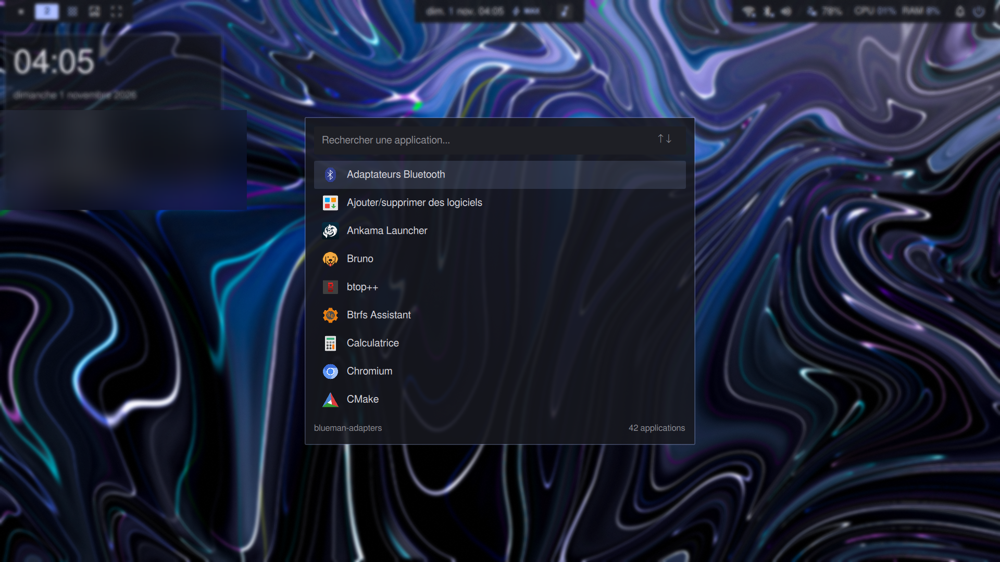
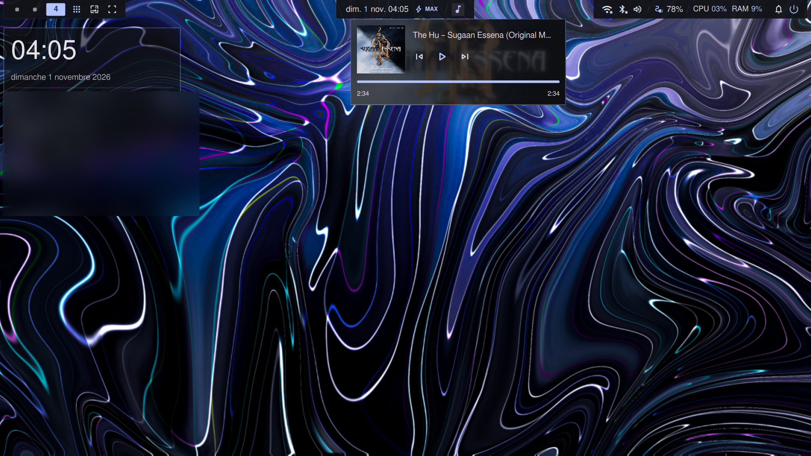
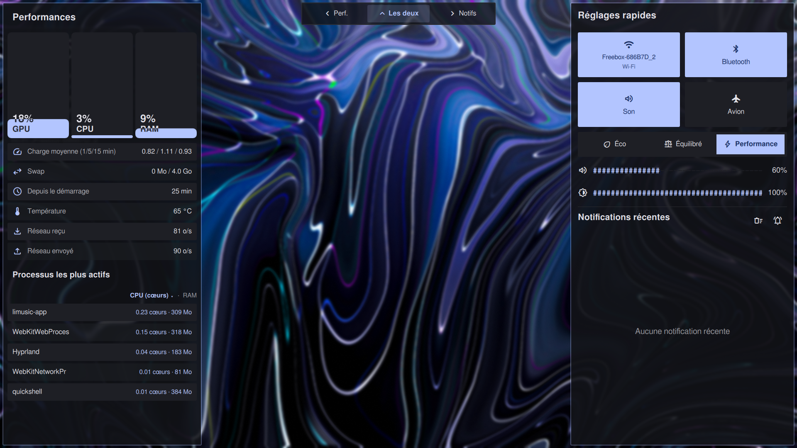
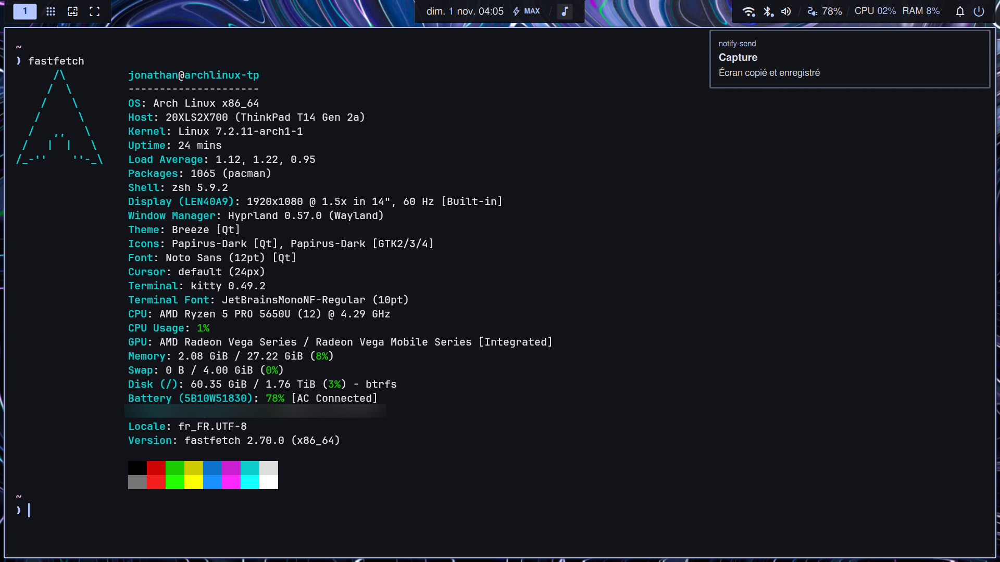
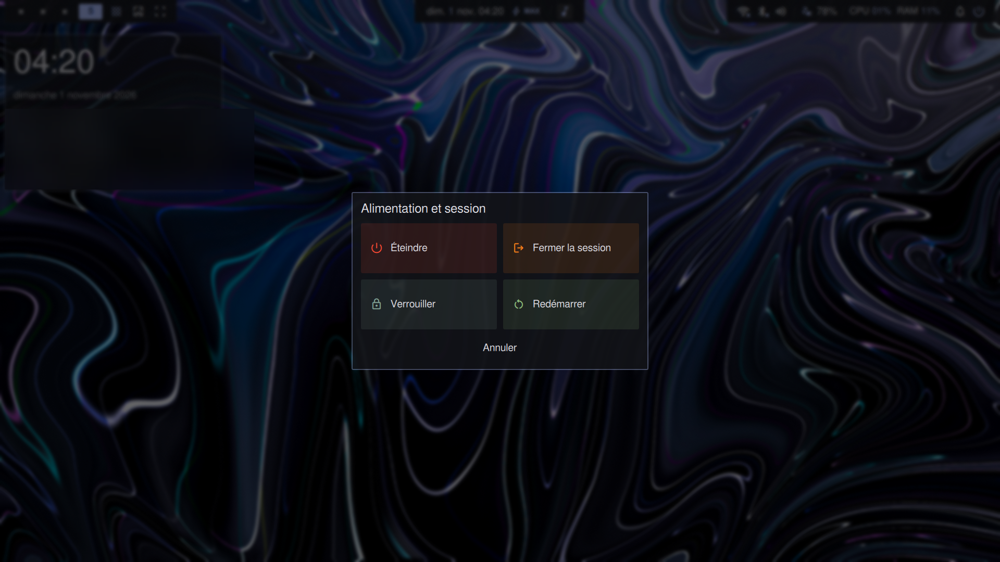
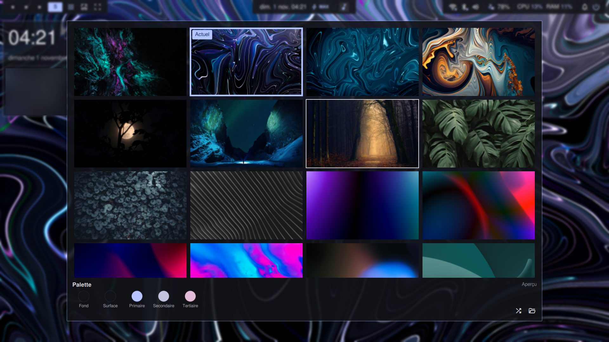

# Quickshell Desktop Configuration

> **Warning:** These dotfiles were made for a **Lenovo ThinkPad T14 Gen 2**.
> They are provided as-is, with no guarantee that they will work correctly on
> other computers. Hardware, display, audio, network, and power-management
> differences will likely require adaptations. Review the configuration and
> scripts before using them on another machine.

## Features

- **Top bar:** Hyprland workspace controls, clock, media controls, battery and
  system indicators, notifications, and power menu.
- **Control panel:** Quick Wi-Fi, Bluetooth, sound, airplane-mode, brightness,
  and TLP power-profile controls; notification history and process/system
  performance information.
- **Desktop widgets:** Clock, weather, system usage, and network status.
- **Wallpaper tools:** Wallpaper picker, random selection, and Matugen-generated
  colors shared with the interface and Hyprland borders.
- **Other panels:** Application launcher, power/session menu, and volume and
  brightness on-screen display.
- **Power behavior:** Optional low-battery profile fallback and eco-mode
  brightness adjustment.

## Screenshots

| Application launcher | Desktop and media controls |
| --- | --- |
|  |  |

| Performance and quick settings | Desktop overview |
| --- | --- |
|  |  |

| Power menu | Wallpaper picker |
| --- | --- |
|  |  |

## Requirements

- Linux with **Wayland** and **Hyprland**.
- [Quickshell](https://quickshell.org/) with the Qt modules used by this
  configuration, including Wayland, Hyprland, UPower, MPRIS, PipeWire, and
  Notifications services.
- Common utilities: `bash`, `curl`, `cat`, `ps`, `nmcli` (NetworkManager),
  `bluetoothctl` (BlueZ), `wpctl` (WirePlumber), `brightnessctl`, `notify-send`,
  `systemctl`, and `hyprctl`.
- **TLP** for power-profile controls. The profile script uses non-interactive
  `sudo -n`; TLP commands therefore need to be permitted by the machine's sudo
  policy.
- **Matugen** for wallpaper color generation.
- Optional integrations: `pavucontrol`, `nm-connection-editor`, `xdg-open`,
  `hyprshutdown`, and a Quickshell-compatible lock screen at
  `~/.local/share/quickshell-lockscreen`.
- A wallpaper collection in `~/Pictures/wallpapers`.

The weather widget fetches current conditions from Open-Meteo and needs an
internet connection. Some system readings depend on Linux `/proc` and `/sys`
interfaces being available.

## Install and run

Place this directory at `~/.config/quickshell`, then generate the default local
configuration before starting the shell:

```sh
cd ~/.config/quickshell
./create-config.sh
qs -p ~/.config/quickshell
```

The shell is designed to run in a Hyprland session. Some commands are launched
through Hyprland IPC and will not work in other compositors without changes.

## Configuration

Edit [`config.jsonc`](./config.jsonc) to change colors, widget location and
refresh intervals, weather coordinates, default control-panel view, power
fallback settings, eco levels, and wallpaper palette labels.

[`create-config.sh`](./create-config.sh) creates a default `config.json` if one
does not already exist and leaves an existing file untouched. This generated
local file is ignored by Git. The current shell loads the tracked
[`config.jsonc`](./config.jsonc); edit that file to customize the active
settings.

The wallpaper picker reads images from `~/Pictures/wallpapers`. The scripts
store the selected wallpaper and generated theme colors under `~/.cache`.

## Hardware and portability notes

- GPU usage is read from AMD-style
  `/sys/class/drm/card*/device/gpu_busy_percent` paths; it may be unavailable
  on other GPUs or kernels.
- Temperature, battery, brightness, and power-profile readings depend on the
  hardware and system services exposed by the host.
- Power controls require a working TLP installation and suitable sudo policy.
- Review paths and commands in `panels/Notifications.qml`,
  `components/PowerSlider.qml`, and `scripts/` when adapting the setup. Some
  script paths may need updating for another user or installation location.
- Power, logout, reboot, lock, network, Bluetooth, and brightness controls
  perform real system actions. Test them carefully.

## Layout

- `shell.qml` — application entry point.
- `panels/` — bar, widgets, launcher, notifications, performance, wallpaper,
  OSD, and power interfaces.
- `components/` — reusable UI elements.
- `theme/Theme.qml` — loads the JSONC settings and generated wallpaper colors.
- `scripts/` — wallpaper, TLP power-profile, and lock-screen helpers.
